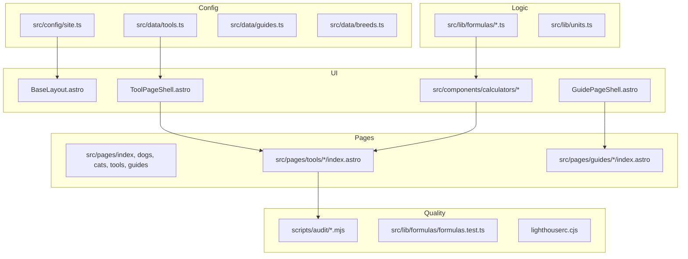

# AGENTS.md — PetCalc Tools

Instructions for AI agents and human contributors working in this repository.

## Governing guidelines

| Document | Purpose |
|---|---|
| [docs/SEO-PLAYBOOK.md](docs/SEO-PLAYBOOK.md) | Technical SEO, GEO, keyword workflow, structured data rules |
| [docs/MARKET-RESEARCH.md](docs/MARKET-RESEARCH.md) | Why pet calculators; niche evidence |
| [docs/ideas/README.md](docs/ideas/README.md) | All 23 site ideas; **this repo = idea #3 (built)** |
| [docs/KEYWORD-MAP.md](docs/KEYWORD-MAP.md) | One primary keyword per page (machine-checked) |
| [docs/SEO-GUIDE.md](docs/SEO-GUIDE.md) | Launch checklist, GSC, 90-day plan |
| [docs/ADSENSE.md](docs/ADSENSE.md) | AdSense eligibility and setup |
| [docs/DEPLOYMENT.md](docs/DEPLOYMENT.md) | Cloudflare Pages / Vercel / Netlify |
| [PROGRESS.md](PROGRESS.md) | Live build status (commit + push on milestones) |

## Project overview

**PetCalc Tools** is a static, client-side pet calculator site (Astro 7 + TypeScript). Eleven calculators (dog + cat), six guides, hub pages, embeddable widgets, and trust pages. No backend; all math in `src/lib/formulas/` with Vitest coverage. Configuration is centralized in `src/config/site.ts`.

### Architecture



## How to add a new tool (step-by-step)

1. **Keyword** — Run the `keyword-research` skill. Add a row to `docs/KEYWORD-MAP.md` (unique primary keyword).
2. **Formula** — Implement in `src/lib/formulas/<name>.ts`; export from `index.ts`; add Vitest cases in `formulas.test.ts`.
3. **Registry** — Add `ToolMeta` in `src/data/tools.ts` (`slug`, `related`, `keywords`).
4. **Calculator UI** — Create `src/components/calculators/<Name>Calc.astro` (form + `<script type="module">` importing formulas). Use `calc-utils.ts` for lb/kg and query-string state.
5. **Page** — `src/pages/tools/<slug>/index.astro` using `ToolPageShell` with answer-first copy, FAQ, sources, disclaimer, ≥600 words in the default slot.
6. **Hubs** — Tool appears automatically via `tools.ts` on `/tools/`, `/dogs/` or `/cats/` as appropriate.
7. **Verify** — `npm run audit` and `npm run lhci` if you changed layout or JS budgets.

### Page template (tool)

```astro
---
import ToolPageShell from '../../../components/ToolPageShell.astro';
import MyCalc from '../../../components/calculators/MyCalc.astro';
// faq, sources arrays...
---
<ToolPageShell slug="my-tool" title="..." description="..." answer="..." takeaways={[...]} faq={faq} sources={sources}>
  <MyCalc slot="calculator" />
  <!-- prose: how to use, formula, worked example, tables, mistakes -->
</ToolPageShell>
```

## Content / SEO / AdSense rules (summary)

- Tool above the fold; ads **after** results (`AdSlot`).
- Answer-first paragraph (40–60 words); cite AAFCO / WSAVA / NRC / AAHA / AAFP on YMYL topics.
- `Disclaimer` + `ReviewerBox` on tools/guides; no medication dosing tools.
- No duplicate intent pages (see KEYWORD-MAP fan-out rules).
- AdSense: `adsensePublisherId` empty until approval; privacy policy disclosures; certified CMP for EEA/UK/CH when enabling ads.

## Quality bar

- `npm run audit` passes (build, 21 formula tests, SEO, AdSense readiness, JS budgets, links).
- Mobile Lighthouse (LHCI): Performance / Accessibility / SEO ≥ 95; LCP ≤ 2.0s, CLS ≤ 0.05, TBT ≤ 150ms on sampled URLs.
- No TODOs, lorem, or stub tools in production pages.

## Commands

| Command | Purpose |
|---|---|
| `npm run dev` | Local dev server |
| `npm run build` | Static output to `dist/` |
| `npm run preview` | Serve `dist/` |
| `npm test` | Vitest formula tests |
| `npm run audit` | Full gate (build + tests + audits + links) |
| `npm run lhci` | Lighthouse CI (run after `npm run build`) |
| `AUDIT_PROD=1 npm run audit` | Treat launch placeholders as errors |

## Definition of done

- [ ] All tools work end-to-end with lb + kg (or appropriate units).
- [ ] Guides and trust pages complete; KEYWORD-MAP matches built routes.
- [ ] `npm run audit` and `npm run lhci` pass.
- [ ] `PROGRESS.md` at 100% and pushed.
- [ ] PR to `main` ready for review with Lighthouse table and screenshots.

## Cursor skills (`.cursor/skills/`)

| Skill | Use when |
|---|---|
| `add-new-tool` | New calculator page |
| `write-seo-article` | New guide or hub copy |
| `keyword-research` | Before KEYWORD-MAP changes |
| `seo-audit` | Fixing `audit:seo` failures |
| `ai-seo-geo-audit` | Crawlers, llms.txt, answer-first structure |
| `adsense-readiness-audit` | Before AdSense application |
| `performance-cwv-audit` | CWV / JS budget regressions |
| `content-refresh` | Updating dates/sources from GSC |
| `internal-linking` | Hubs, related tools, orphans |
| `structured-data` | JSON-LD changes |
| `vet-source-citation` | YMYL sources and disclaimers |

## Cursor rules (`.cursor/rules/`)

`seo-pages.mdc`, `content-quality.mdc`, `ymyl-disclaimers.mdc`, `performance-budget.mdc`, `accessibility.mdc` — apply on matching globs.

## Subagents (`.cursor/agents/`)

| Agent | Role |
|---|---|
| `seo-auditor` | Run/fix `scripts/audit/seo.mjs` |
| `content-writer` | Guides and tool prose |
| `adsense-reviewer` | Policy + `audit:adsense` |
| `performance-auditor` | `audit:budgets`, `lhci` |
| `link-builder-researcher` | Outreach ideas (no spam) |
| `vet-fact-checker` | Sources, formulas, emergency copy |

Use the same roles when delegating to other agent tools.
