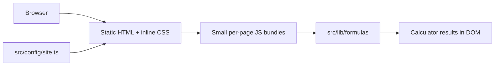

# PetCalc Tools

Free, privacy-first **pet calculators** for dogs and cats: puppy weight prediction, RER/MER feeding amounts, age conversion, chocolate toxicity screening, water intake, pregnancy due dates, and more. Built as a static Astro site for SEO, AdSense readiness, and AI-search citation.

**Governing research:** [docs/MARKET-RESEARCH.md](docs/MARKET-RESEARCH.md), [docs/SEO-PLAYBOOK.md](docs/SEO-PLAYBOOK.md), [docs/ideas/README.md](docs/ideas/README.md) (niche #3 in the ideas index).

**Agent / contributor guide:** [AGENTS.md](AGENTS.md) · **Live build status:** [PROGRESS.md](PROGRESS.md)

---

## Goals

- Rank for long-tail pet calculator queries with breed-aware data and vet-cited content.
- Pass Google AdSense review after launch traffic (tools + guides + trust pages).
- Stay fast on mobile (client-side math, minimal JS, reserved ad slots).
- Remain easy for humans and AI agents to extend (skills, audits, keyword map).

---

## Live tool list

| Tool | Path |
|---|---|
| Puppy weight calculator | `/tools/puppy-weight-calculator/` |
| Dog food calculator | `/tools/dog-food-calculator/` |
| Puppy food calculator | `/tools/puppy-food-calculator/` |
| Homemade / raw dog food calculator | `/tools/homemade-dog-food-calculator/` |
| Dog age calculator | `/tools/dog-age-calculator/` |
| Cat age calculator | `/tools/cat-age-calculator/` |
| Cat food calculator | `/tools/cat-food-calculator/` |
| Dog BMI / body condition helper | `/tools/dog-bmi-calculator/` |
| Dog pregnancy / due date calculator | `/tools/dog-pregnancy-calculator/` |
| Dog chocolate toxicity calculator | `/tools/dog-chocolate-toxicity-calculator/` |
| Dog water intake calculator | `/tools/dog-water-intake-calculator/` |

**Hubs:** [`/`](.) · [`/tools/`](src/pages/tools/index.astro) · [`/dogs/`](src/pages/dogs/index.astro) · [`/cats/`](src/pages/cats/index.astro) · [`/guides/`](src/pages/guides/index.astro)

**Embeds (noindex):** `/embed/puppy-weight-calculator/` · `/embed/dog-food-calculator/`

---

## Tech stack

| Layer | Choice |
|---|---|
| Framework | [Astro 7](https://astro.build) static output |
| Language | TypeScript (strict) |
| Interactivity | Vanilla `<script type="module">` islands (no React) |
| Tests | Vitest (`src/lib/formulas/formulas.test.ts`) |
| Audits | Custom `scripts/audit/*`, Lighthouse CI |
| Hosting | Static (`dist/`) — Cloudflare Pages primary |

### Architecture



All calculator logic runs in the browser. No uploads, no API keys in the client.

---

## Folder structure

```text
/
├── src/
│   ├── config/site.ts          # Brand, domain, GA4, AdSense, IndexNow (single config file)
│   ├── data/                   # tools.ts, guides.ts, breeds.ts, sources.ts
│   ├── lib/formulas/           # RER/MER, puppy weight, toxicity, etc. + tests
│   ├── components/             # Layout shells, calculators, SEO blocks
│   ├── layouts/BaseLayout.astro
│   └── pages/                  # Routes (tools/, guides/, trust pages)
├── public/                     # favicon, _headers, ads.txt, robots helpers, og image
├── scripts/audit/              # SEO, AdSense, links, budgets
├── docs/                       # DEPLOYMENT, SEO-GUIDE, ADSENSE, KEYWORD-MAP, ideas/
├── .cursor/skills|rules|agents # Cursor project automation
├── lighthouserc.cjs            # Mobile Lighthouse budgets
├── AGENTS.md                   # Contributor / agent instructions
└── PROGRESS.md                 # Milestone tracker (pushed to remote)
```

---

## Prerequisites

- **Node.js** `>= 22.22.0` (see `engines` in `package.json`)
- npm 9+

---

## Local setup

```bash
git clone https://github.com/hammadiqbal6/pet-calculators.git
cd pet-calculators
npm ci
npm run dev
```

Open `http://localhost:4321/`. Production build:

```bash
npm run build
npm run preview
```

---

## Scripts / commands

| Script | Description |
|---|---|
| `npm run dev` | Astro dev server |
| `npm run build` | Build to `dist/` |
| `npm run preview` | Preview production build |
| `npm test` | Vitest formula unit tests |
| `npm run audit:seo` | SEO checks on `dist/` (run after build) |
| `npm run audit:adsense` | AdSense readiness on `dist/` |
| `npm run audit:budgets` | JS size budgets per page |
| `npm run check:links` | Internal link checker |
| `npm run audit` | **Full gate:** build + test + all audits + links |
| `npm run lhci` | Lighthouse CI (mobile, after `npm run build`) |

Use `AUDIT_PROD=1 npm run audit` before production deploy to fail on placeholder domain/reviewer/IndexNow.

---

## Configuration

All owner-specific values live in **`src/config/site.ts`** (not scattered in pages).

| Field / env | Purpose |
|---|---|
| `siteName`, `brandName`, `tagline` | UI and schema branding |
| `PUBLIC_SITE_URL` → `siteUrl` | Canonical origin (`https://…`, no trailing slash); required in production |
| `PUBLIC_CONTACT_EMAIL` → `contactEmail` | Contact/privacy/terms `mailto:`, footer, Organization schema; default `hammadiqbal117@gmail.com` |
| `buildDate` | `lastmod`, “Last updated”, JSON-LD `dateModified` |
| `PUBLIC_GA4_MEASUREMENT_ID` → `ga4MeasurementId` | Google Analytics 4 (`G-…`); empty = no analytics code |
| `PUBLIC_GSC_VERIFICATION` → `googleSiteVerification` | GSC HTML-tag `content` value; empty = no meta tag |
| `bingSiteVerification` | Bing Webmaster meta tag; empty = disabled |
| `adsensePublisherId` | `ca-pub-…`; empty = ads disabled |
| `adsenseAutoAds` | Enable Auto ads when publisher ID is set |
| `indexNowKey` | IndexNow key + `public/<key>.txt` |
| `sameAs` | Organization `sameAs` URLs (real profiles only) |
| `defaultAuthor` | Author byline |
| `reviewerPlaceholder` | Reviewer box until a credentialed DVM is named |
| `locale`, `twitterHandle` | OG locale / Twitter card |

See **`.env.example`** for build env vars. Deploy target: Cloudflare Worker `pet-calculators` (`wrangler.jsonc`).

---

## How to add a tool or article

See **[AGENTS.md](AGENTS.md)** (step-by-step) and the **`add-new-tool`** / **`write-seo-article`** skills under `.cursor/skills/`.

Short version:

1. Update **`docs/KEYWORD-MAP.md`** (unique primary keyword).
2. Add formula + tests → calculator component → `src/data/tools.ts` or `guides.ts`.
3. Add page under `src/pages/tools/<slug>/` or `src/pages/guides/<slug>/`.
4. Run **`npm run audit`**.

---

## Testing

```bash
npm test
```

Covers unit conversions, RER/MER, puppy weight prediction, dog/cat age, homemade rations, BMI/BCS, pregnancy dates, chocolate toxicity bands, and water intake ranges.

---

## Audits and CI

```bash
npm run audit      # recommended before every PR
npm run lhci       # mobile Lighthouse on key templates
```

GitHub Actions (`.github/workflows/ci.yml`) on pull requests: install → test → build → `audit:seo` → `audit:adsense` → `audit:budgets` → `check:links`, then Lighthouse job.

---

## Performance budgets

Enforced in `lighthouserc.cjs` and `scripts/audit/budgets.mjs`:

| Metric | Budget |
|---|---|
| Lighthouse Performance (mobile) | ≥ 95 |
| LCP | ≤ 2.0 s |
| CLS | ≤ 0.05 |
| TBT | ≤ 150 ms |
| Total JS (gzip, per page) | ≤ 50 KB (audit script); LHCI script bundle ≤ 60 KB |

Latest local LHCI (static `dist/`, mobile emulation): **100** Performance / Accessibility / SEO on home, tools hub, puppy weight, dog food, cat age, chocolate tool, sample guide, and privacy; LCP ~0.75–1.05 s, CLS 0, TBT 0 ms.

---

## SEO / AI-SEO approach (summary)

- One primary keyword per page ([docs/KEYWORD-MAP.md](docs/KEYWORD-MAP.md)); hubs avoid cannibalization.
- Answer-first paragraphs, formulas, worked examples, FAQs, cited sources (WSAVA, AAFCO, NRC, etc.).
- JSON-LD: Organization, WebSite, BreadcrumbList, WebApplication per tool, Article per guide.
- `robots.txt` allows search + AI answer crawlers; optional `public/llms.txt`.
- IndexNow key file for Bing/Yandex (documented in [docs/SEO-GUIDE.md](docs/SEO-GUIDE.md)).

Full playbook: [docs/SEO-PLAYBOOK.md](docs/SEO-PLAYBOOK.md). Launch steps: [docs/SEO-GUIDE.md](docs/SEO-GUIDE.md).

---

## AdSense setup (summary)

1. Launch with quality content and traffic (~20–30 pages, real visitors).
2. Fill `adsensePublisherId` in `site.ts`; update `public/ads.txt`.
3. Enable slots via `AdSlot.astro` (reserved height to limit CLS).
4. Add a **Google-certified CMP** for EEA/UK/CH before personalized ads.

Details: [docs/ADSENSE.md](docs/ADSENSE.md).

---

## Deployment quick-start

1. Set `siteUrl` and contact email in `src/config/site.ts`.
2. `AUDIT_PROD=1 npm run audit`
3. Connect repo to **Cloudflare Pages**: build `npm run build`, output `dist`, Node 22.
4. Attach custom domain; enforce HTTPS and single www/apex canonical (see redirects).

Full guide: **[docs/DEPLOYMENT.md](docs/DEPLOYMENT.md)**

---

## Post-launch SEO

1. **Google Search Console** — domain property, submit `sitemap-index.xml`, URL inspection for flagship tools.
2. **Bing Webmaster Tools** — import from GSC, submit sitemap, configure IndexNow.
3. **GA4** — set `ga4MeasurementId` when ready.
4. Optimize from GSC queries (positions 8–30).

Checklist: [docs/SEO-GUIDE.md](docs/SEO-GUIDE.md#1-launch-checklist).

---

## Docs index

| File | Description |
|---|---|
| [docs/DEPLOYMENT.md](docs/DEPLOYMENT.md) | Cloudflare / Vercel / Netlify |
| [docs/SEO-GUIDE.md](docs/SEO-GUIDE.md) | Launch + 90-day SEO plan |
| [docs/SEO-PLAYBOOK.md](docs/SEO-PLAYBOOK.md) | Research-backed SEO/GEO rules |
| [docs/ADSENSE.md](docs/ADSENSE.md) | AdSense eligibility and setup |
| [docs/KEYWORD-MAP.md](docs/KEYWORD-MAP.md) | Page ↔ keyword ownership |
| [docs/MARKET-RESEARCH.md](docs/MARKET-RESEARCH.md) | Niche research report |
| [docs/ideas/README.md](docs/ideas/README.md) | 23 ideas index + pet add-on backlog |
| [AGENTS.md](AGENTS.md) | Architecture, adding tools, definition of done |
| [PROGRESS.md](PROGRESS.md) | Build milestone tracker |

**Cursor:** `.cursor/skills/`, `.cursor/rules/`, `.cursor/agents/` (see [AGENTS.md](AGENTS.md)).

---

## Troubleshooting

| Issue | Fix |
|---|---|
| Astro requires Node ≥ 22.22 | `nvm use 22` or install Node 22 LTS |
| `audit:seo` fails on KEYWORD-MAP | Add route row in `docs/KEYWORD-MAP.md` |
| Broken internal links | `npm run check:links`; fix hrefs to use trailing slashes |
| Lighthouse CI fails | `npm run build && npm run lhci`; check `lighthouserc.cjs` |
| Placeholder domain warnings | Expected until `siteUrl` is set; `AUDIT_PROD=1` fails in prod CI |

---

## Proof

Committed SEO, performance, and AdSense evidence (generated, not hand-edited):

- **[docs/proof/README.md](docs/proof/README.md)** — index with tool versions, pass/fail vs budgets, Lighthouse summary table
- Regenerate locally: `npm run proof` (build → tests → audits → Lighthouse → screenshots → JSON-LD extract)

CI uploads the same folder as the `docs-proof` artifact on pull requests.

## Roadmap

- Credentialed veterinary reviewer for YMYL pages.
- Additional **backlog** tools from [docs/ideas/README.md](docs/ideas/README.md) (dog food switch, litter box sizing, etc.) after keyword validation.
- Content calendar articles in [docs/SEO-GUIDE.md](docs/SEO-GUIDE.md).
- Separate repos for other ideas (#1 home & garden, #2 marketplace fees, …).

---

## License

Source code in this repository is provided for the site owner’s use. Calculator content cites third-party guidelines (AAFCO, WSAVA, NRC, etc.); verify rates and medical guidance with qualified professionals before relying on them commercially. Replace placeholder `siteUrl`, contact, and reviewer fields before public launch.
